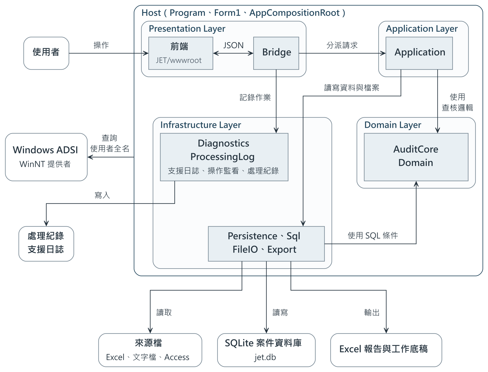

## 1. Document Overview & Control

| 項目 | 內容 |
|---|---|
| 軟體名稱與版本 | JE Tool（以下簡稱 JET）1.0.0.0，首次發布。 |
| 文件目的 | 記載 JET 的範圍、架構、第三方元件、安全、測試與部署。 |
| 讀者 | JET 的複核人員，以及維護 JET 的開發人員。 |
| 文件負責人 | 待填 |
| 核准狀態 | 待填 |
| 複核日期 | 待填 |

| 版次 | 日期 | 修訂說明 |
|---|---|---|
| 0.1 | 2026-11-16 | 初版。 |

## 2. Software Overview & Scope

| 項目 | 內容 |
|---|---|
| 業務目的 | 供查核人員執行分錄測試（JE Test）的 Windows 桌面應用程式。使用者匯入受查者的總帳（GL）與試算表（TB），測試後匯出 Excel 工作底稿。 |
| 主要功能 | 六個步驟：建立案件、匯入資料、欄位配對、資料驗證與測試、進階條件篩選、匯出底稿。 |
| 使用者 | 執行分錄測試的查核人員。 |
| 系統邊界 | 單機執行。案件資料存放於本機的 SQLite 資料庫，不連線至遠端資料庫；外部服務見第 4 節。 |
| 假設 | 執行環境為 Windows 11 64 位元，已安裝 WebView2 Runtime。GL 與 TB 由查核團隊向受查者取得。 |
| 限制 | 匯入 Access 資料表前，須先安裝 64 位元 Access Database Engine。案件根資料夾須位於本機磁碟，不接受網路路徑。其餘見第 19 節。 |
| 範圍外事項 | JET 不作成查核結論。案件資料的缺失與風險由查核人員判斷，並於工作底稿說明。 |

## 3. Requirements & Constraints

| 類別 | 需求 |
|---|---|
| 功能 | 六個步驟的功能，見第 2 節。 |
| 效能 | 資料處理方式見第 6 節的架構決策；前端僅載入摘要與分頁資料，每頁 200 筆。尚未建立效能基準，量測方式見第 14 節。 |
| 可用性與延展性 | 不適用。JET 為單機桌面應用程式，無常駐服務；每個案件使用一個資料庫檔。 |
| 無障礙 | 未訂定無障礙標準。文字對比的規則見 Design Principle.docx 第 2 節。 |
| 安全 | 見第 12 節。 |
| 相容性 | Windows 11 64 位元。匯入 Excel（.xlsx、.xlsm、.xls）、文字檔（.csv、.txt）與 Access（.mdb、.accdb）；輸出 Excel（.xlsx）。 |
| 驗收條件 | 自動化測試全數通過；Code Review 的結論為通過或例外核准。 |
| 需求依據 | 查核邏輯沿用舊版 JET（IDEA 版），並依查核團隊的作業需求調整。 |

## 4. Technology Stack & Dependencies

元件清冊與弱點查詢見第 5 節。

| 項目 | 採用內容 |
|---|---|
| 語言與框架 | C#、.NET 10（net10.0-windows）。WinForms 視窗內嵌 WebView2，載入隨 JET 發布的本機頁面。 |
| 前端 | HTML、CSS 與 JavaScript；圖表採用 Apache ECharts。 |
| 資料庫 | SQLite 3.53.4，經 Microsoft.Data.Sqlite 與 SQLitePCLRaw.bundle_e_sqlite3 存取。 |
| Excel 與 Access | DocumentFormat.OpenXml、ExcelDataReader、System.Data.OleDb；ClosedXML 僅用於 Debug 組態的示範資料檔。 |
| 其他套件 | Microsoft.Web.WebView2、Microsoft.Extensions.Logging。 |
| 外部服務 | 網域控制站（domain controller）：登入帳號為網域帳號時，Windows 可能向其查詢使用者全名，見第 11 節。 |
| 相容性限制 | 僅提供 win-x64 發布檔，內含 .NET runtime。WebView2 Runtime 與 Access Database Engine 不隨 JET 發布。 |

## 5. Dependency Security: SBOM & SCA

### 5.1 SBOM Inventory & Traceability

| 項目 | 內容 |
|---|---|
| 涵蓋範圍 | JET 的 repository 引用的第三方元件。應用程式專案直接引用 9 個 NuGet 套件，含間接引用共 23 個；測試專案另引用 34 個套件，不隨 JET 發布。前端另含 Apache ECharts、圖示與字型。 |
| 容器 | 不適用，JET 不以容器發布。 |
| 發布檔 | 清冊依原始碼的套件引用整理，未掃描發布檔。 |
| 排除項目 | Windows、Microsoft Office、Access Database Engine 與 WebView2 Runtime。發布檔內含的 .NET 10 runtime 未列入清冊，其版本依建置時的 .NET SDK 而定。 |
| 維護責任 | 開發人員於套件變更時更新清冊。 |
| 元件識別 | 以元件名稱與版本識別；清冊未列供應商與其他識別碼。 |
| 相依關係 | 下表為直接引用的元件；間接引用的 14 個套件未逐項列出。 |
| 產生方式 | 未使用 SBOM 產生工具。依開發環境的套件還原結果整理，授權依各元件的宣告核對。 |
| 格式 | 表列。尚未產出 SPDX 或 CycloneDX 格式的 SBOM。 |
| 存放與保存期限 | 清冊列於本節；套件與版本宣告於 JET/JET.csproj 與 tests/JET.Tests/JET.Tests.csproj。存取方式與保存期限：未訂定。 |
| 追溯 | 對應 JET 1.0.0.0。commit ID、build ID 與發布檔雜湊值：待填 |

所列元件無須另購商業授權。授權聲明檔的現況見第 19 節。

| 元件 | 版本 | 授權 |
|---|---|---|
| ClosedXML | 0.105.1 | MIT |
| DocumentFormat.OpenXml | 3.5.1 | MIT |
| ExcelDataReader | 3.9.0 | MIT |
| Microsoft.Data.Sqlite | 10.0.13 | MIT |
| Microsoft.Extensions.Logging | 10.0.13 | MIT |
| Microsoft.Extensions.Logging.Abstractions | 10.0.13 | MIT |
| Microsoft.Web.WebView2 | 1.0.4258.31 | Microsoft WebView2 SDK 授權（BSD-3-Clause 形式） |
| SQLitePCLRaw.bundle_e_sqlite3 | 3.0.5 | Apache-2.0；內含的 SQLite 3.53.4 為公有領域（public domain） |
| System.Data.OleDb | 10.0.13 | MIT |
| Apache ECharts（含 ZRender、tslib 與 d3.js 子元件） | 5.5.0 | Apache-2.0；ZRender 與 d3.js 為 BSD-3-Clause，tslib 為 0BSD |
| Fluent UI System Icons | 1.1.344 | MIT |
| Instrument Sans | Google Fonts v4 | SIL Open Font License 1.1 |
| Noto Sans TC | 未標示 | SIL Open Font License 1.1 |

### 5.2 SCA & Remediation

| 項目 | 內容 |
|---|---|
| 工具與範圍 | .NET 10 SDK 的 NuGet 套件弱點查詢（dotnet package list）；範圍為應用程式專案直接與間接引用的 NuGet 套件，不含發布檔內含的 .NET runtime 與前端的第三方元件。 |
| 資料來源 | nuget.org 提供的公開弱點資料。 |
| 查詢日期與結果 | 2026-11-06 查詢，未發現已知弱點。 |
| 已處置事項 | GitHub 公告 GHSA-2m69-gcr7-jv3q：SQLitePCLRaw.lib.e_sqlite3 2.1.11 及更早的版本內含受 CVE-2025-6965（CVSS 4.0 分數 7.2）影響的 SQLite，建議升級至 SQLite 3.50.2 以上。專案直接引用 SQLitePCLRaw.bundle_e_sqlite3 3.0.5，取代 Microsoft.Data.Sqlite 10.0.13 宣告引用的 2.1.13；套件還原結果不含公告所列的套件，SQLite 為 3.53.4。 |
| 授權檢查 | 逐一核對直接與間接引用元件的授權。直接引用元件的結果見第 5.1 節；間接引用的 14 個套件為 MIT 9 個、Apache-2.0 4 個，以及公有領域的 SQLite。 |
| 停止維護元件的檢查 | 未執行。 |
| 誤判 | 無。 |
| 處置責任與期限 | 開發人員更新套件後重新查詢。處置期限：未訂定。 |
| 複核與例外核准的責任 | 待填 |
| 元件核准與授權政策 | 未訂定。 |
| 合併與發布的阻擋條件 | 未訂定。 |
| 例外核准 | 無。 |

查詢命令：

```
dotnet package list --project JET/JET.csproj `
  --no-restore --vulnerable --include-transitive `
  --format json --output-version 1
```

### 5.3 CI/CD & Release Evidence

未建置 CI/CD pipeline，見第 15 節。弱點查詢於開發環境執行，最近一次見第 5.2 節。

| 項目 | 內容 |
|---|---|
| 1.0.0.0 的元件清冊與查詢結果 | 見第 5.1 節與第 5.2 節。 |
| 發布前的弱點查詢 | 待填 |
| 查詢報告的保存 | 未訂定。 |
| 發布後出現新弱點時的重新評估 | 未訂定。 |
| 未結事項與例外核准 | 無。 |
| 核准決定與簽核日期 | 待填 |

## 6. System Architecture



| 層級 | 模組 | 職責 |
|---|---|---|
| Host | Program、Form1、AppCompositionRoot | 建立 WinForms 視窗與 WebView2，組裝各層的物件，並於啟動時查詢登入帳號的使用者全名。 |
| Presentation Layer | JET/wwwroot、Bridge | 前端接收使用者的輸入並呈現結果；Bridge 接收並分派前端送出的請求（action）。 |
| Application Layer | Application | 各請求的 handler；協調資料的讀取、查核邏輯的計算與結果的儲存。 |
| Domain Layer | AuditCore、Domain | AuditCore 執行查核邏輯的判定與計算；Domain 定義 data contract、基本型別、規則定義（Domain/Rules）與資料存取介面（多數位於 Domain/Abstractions 與 Domain/Contracts）。 |
| Infrastructure Layer | Infrastructure | SQLite 存取、來源檔讀取、報告與工作底稿輸出、日誌。 |

前端與後端的請求、回應與事件經 WebView2 的 Web 訊息通道交換，見第 11 節；關閉視窗時，Host 另執行 JavaScript 呼叫前端的函式。部署模型為單機，發布資料夾複製至使用者的電腦後執行。設計假設見第 2 節。

| 架構決策 | 理由 | 取捨 |
|---|---|---|
| 篩選與彙總於 SQLite 以 SQL 執行 | 前端無須載入完整的 GL。 | 每次查詢皆須存取資料庫。 |
| 前端採網頁技術，由 WebView2 載入 | 執行環境已有 WebView2 Runtime，無須另行安裝。 | WebView2 Runtime 不隨 JET 發布，執行環境須具備。 |
| 單機執行，每個案件一個資料庫檔 | 無須資料庫伺服器；案件以資料夾為單位複製與搬移。 | 案件根資料夾須位於本機磁碟，不接受網路路徑。 |
| 查核邏輯的判定集中於 AuditCore，規則定義置於 Domain/Rules | 前端、報告與工作底稿使用同一份計算結果。 | 前端不計算金額，也不執行查核邏輯。 |

## 7. Diagrams & Technical Design

Diagrams 資料夾內的圖檔為 .png；文字定義為同名的 .txt，採 PlantUML 格式與 UTF-8 編碼。

| 圖表 | 內容 | 檔案 |
|---|---|---|
| 系統架構圖 | 系統情境（使用者、來源檔、案件資料庫與輸出檔）、各層的模組與呼叫方向。 | 第 6 節 |
| 元件圖 | 內部元件、介面與外部元件。 | Diagrams/Structure Diagrams/Component Diagram |
| 類別圖 | 處理資料驗證與匯出工作底稿兩項請求的主要類別。 | Diagrams/Structure Diagrams/Class Diagram |
| 活動圖 | 「資料驗證與測試」步驟的作業流程。 | Diagrams/Behavior diagrams/Activity Diagram |
| 實體關聯圖（ERD） | 案件資料庫的 29 張資料表與欄位。圖中的連線表示查詢時用於關聯的欄位；資料庫未宣告外鍵。 | Diagrams/ERD |
| 開發至部署的流程圖 | 自開發、測試至正式部署各階段的作業與文件。 | Workflow.xlsx |
| 循序圖、資料流程圖、部署圖 | 未提供。部署模型見第 6 節。 | 無 |

信任邊界為使用者的 Windows 工作階段，JET 與 WebView2 的處理程序均於其中執行。JET 未實作網路連線；外部服務見第 4 節。外部輸入為使用者選取的來源檔、前端送出的請求與 Windows 回傳的使用者全名，控制見第 12.1 節。

## 8. Source Code Structure & Development Standards

以下路徑以方案檔 JET.slnx 所在的資料夾為起點。

| 位置 | 內容 |
|---|---|
| JET.slnx | 方案檔，含應用程式專案與測試專案。 |
| JET/Program.cs、Form1.cs | 進入點；建立視窗並初始化 WebView2。 |
| JET/wwwroot | 前端的本機頁面、字型與圖示。 |
| JET/Bridge、Application、AuditCore、Domain、Infrastructure | 各層的模組，職責見第 6 節。 |
| JET/Templates | 隨 JET 發布的 8 份 Excel 範本。 |
| tests/JET.Tests、tests/frontend | 後端測試與前端測試。 |

| 項目 | 內容 |
|---|---|
| 撰寫慣例 | 見 Design Principle.docx。 |
| 命名慣例 | 見 Design Principle.docx 第 4 節。 |
| Commit 慣例 | commit message 以繁體中文撰寫；標題以一行摘要變更內容，內文說明主要變更與原因。 |

## 9. Development Environment & Configuration

| 項目 | 用途 |
|---|---|
| Windows 11 64 位元 | 開發與執行。 |
| .NET 10 SDK | 建置應用程式與後端測試。 |
| Node.js 26 | 執行前端測試。 |
| Visual Studio 或 VS Code | 編輯、偵錯與發布。 |
| Microsoft Excel | 開啟匯出的活頁簿，確認內容與相容性。 |

以 Visual Studio 開啟 JET.slnx，或以 VS Code 開啟方案資料夾。建置與執行：

```
dotnet build JET.slnx -c Debug
dotnet run --project JET/JET.csproj -c Debug
```

JET 讀取的環境變數僅 JET_PROJECTS_ROOT 一項，用於指定案件根資料夾，例如 `D:\JET`；未設定時為 `%USERPROFILE%\JET`。除各案件的設定檔 project.json（見第 10 節）外，JET 無其他設定檔。開發環境與正式環境僅建置組態不同。

## 10. Data Design & Management

每個案件一個資料夾，位於案件根資料夾之下，內含案件設定檔 project.json、資料庫 jet.db、報告、工作底稿與支援日誌。資料表與欄位見 ERD。

| 項目 | 內容 |
|---|---|
| 資料模型 | 來源資料原樣保存；欄位配對確認後另建標準化的 GL 與 TB。資料驗證、預篩選、資料可靠性測試、篩選情境與操作紀錄各有資料表。 |
| 金額 | 以整數儲存，精度至小數第 4 位；顯示格式不影響計算值。 |
| 資料檢查 | 匯入多個來源檔時，欄位不一致則不匯入。欄位配對確認時記錄存入的筆數與借貸合計，資料驗證時核對。 |
| Schema 版本與移轉 | 資料庫 schema 為第 20 版。版本不符的案件無法開啟，須刪除後重新建立；未提供移轉機制。 |
| 保存 | 案件資料存放於本機，由使用者保存或刪除；JET 不自動清除。 |
| 備份與復原 | 關閉 JET 後複製整個案件資料夾；復原時，將備份的資料夾以原名稱複製至案件根資料夾。資料夾名稱與案件名稱不符時無法開啟。 |
| 機敏資料 | 案件資料可能含受查者的機密資訊與人員名稱，僅於本機處理。「建案者」的使用者全名或帳號短名記錄於案件設定檔，並寫入資料驗證報告、預篩選報告與條件篩選報告的「Prepared by」欄位。支援日誌不記錄案件內容。案件設定檔與資料庫未加密。 |

## 11. APIs & External Integrations

JET 未提供對外的 API。前端與後端以 WebView2 的 Web 訊息通道交換 JSON 訊息，handler 位於 JET/Application/Handlers。

| 項目 | 內容 |
|---|---|
| 請求 | requestId、action（請求名稱，例如 validate.run）與 payload。 |
| 成功回應 | 相同的 requestId、ok 為 true、data，以及供日誌對照的 correlationId。 |
| 失敗回應 | 相同的 requestId、ok 為 false、correlationId；error 含錯誤碼 code 與中文的錯誤訊息 message，並可含 field 與 details。非預期的例外回覆固定的錯誤訊息。 |
| 事件 | 後端主動送出的進度訊息，含 event 與 data，不含 requestId。 |
| 身分驗證 | Web 訊息通道不適用，通道僅存在於本機的 JET 與其 WebView2 之間。查詢使用者全名時，JET 未另行指定帳號與密碼。 |
| 逾時與重試 | Web 訊息通道未設逾時，請求失敗後不自動重送。「訊息」區紀錄的寫入（log.append）失敗時，留待下次狀態變更再送出。讀取 Access 資料表的查詢逾時為 30 秒。使用者全名於 JET 啟動時在背景查詢一次，建立案件時最多等候 3 秒；查詢失敗或逾時，建案者記為帳號短名。長時間作業可由使用者取消。 |
| 版本 | JSON 訊息的格式不另編版本，隨 JET 的版本發布。 |
| 整合的相依項目 | 以 Open XML 讀取 .xlsx 與 .xlsm、寫入 .xlsx，以 ExcelDataReader 讀取 .xls，以 Access Database Engine 讀取 Access 資料表。以 Windows 內建的 ADSI（Active Directory Service Interfaces）WinNT 提供者讀取登入帳號的使用者全名；登入帳號為網域帳號時，Windows 可能向網域控制站查詢。 |

請求與回應範例：

```
請求
{ "requestId": "11111111-2222-4333-8444-555555555555",
  "action": "system.ping", "payload": {} }

成功回應
{ "requestId": "11111111-2222-4333-8444-555555555555", "ok": true,
  "data": { "message": "JET host bridge ok.",
            "utcNow": "2026-11-12T08:30:00.1234567+00:00",
            "devToolsEnabled": false },
  "error": null,
  "correlationId": "0123456789abcdef0123456789abcdef" }

失敗回應（validate.run 的 payload 為 { "sampleSize": 0 }）
{ "requestId": "66666666-7777-4888-8999-000000000000", "ok": false,
  "data": null,
  "error": { "code": "invalid_payload",
             "message": "抽樣筆數請填入 1 到 1048524 的整數。",
             "field": "sampleSize" },
  "correlationId": "fedcba9876543210fedcba9876543210" }
```

## 12. Application Security & GitHub Security

### 12.1 Application Security

| 項目 | 現行控制 |
|---|---|
| 身分驗證與授權 | JET 未設登入機制，以 Windows 登入帳號識別使用者。案件檔案的存取由 Windows 檔案權限控管。 |
| 資料保護 | 案件資料僅於本機處理，不傳送至外部。 |
| 輸入檢查 | SQL 採參數化查詢，欄位名稱與排序鍵以 allowlist 限制；規則見 Design Principle.docx 第 6 節。日期輸入框的上限為 9999-12-31；建立案件時，查核起始日與查核截止日的年份須在 1900 到 2100 之間，不符時回覆錯誤碼 invalid_payload。Windows 回傳的使用者全名先去除前後空白；去除後為空字串、含控制字元或超過 256 個字元時，建案者記為帳號短名。 |
| 機密管理 | 原始碼未包含密碼、金鑰或 token。 |
| 介面與 runtime 的安全 | WebView2 主框架僅允許導覽至本機頁面，封鎖新視窗，停用 host objects；Release 組態停用開發人員工具。前端未使用 iframe，子框架的導覽未另行限制。非預期例外的處理見第 11 節。 |
| 檔案輸出 | 報告與工作底稿寫入案件資料夾；暫存檔、檔名與覆寫的規則見 Design Principle.docx 第 6 節。 |
| 弱點通報與處置 | 待填 |

### 12.2 GitHub & Repository Security

尚未執行 GitHub 掃描。第三方元件的清冊與弱點查詢見第 5 節。

| 項目 | 設定 |
|---|---|
| 存取權限 | 待填 |
| Branch protection、required reviews 與 required checks | 待填 |
| Secret scanning 與 push protection | 待填 |
| Code scanning | 待填 |
| Dependabot alerts 與 dependency review | 待填 |
| 安全警示的處理 | 待填 |
| Workflow permissions | 待填 |

## 13. Code Review

| 項目 | 內容 |
|---|---|
| 複核流程 | 見 Code Review/Code review rule.docx。 |
| 驗收依據與測試佐證 | 原始碼以自動化測試的結果為主要驗收依據，結果見 Code Review/Unit test Report.xlsx。 |
| 人工複核的範圍 | 六項核心查核邏輯，以及程式內的固定值與規則（hard-coded content）。範圍依風險決定：直接影響查核結果的邏輯由人工複核。 |
| 技術檢查表與紀錄 | Code Review/Code review.xlsx，含「複核紀錄」「複核範圍」「固定值與規則」三張工作表。 |
| 核准條件 | 複核結論須為通過或例外核准。結論為需修正時，修正完成前不得合併或發布。 |
| 安全與第三方元件變更的複核 | 安全的檢查項目見「複核紀錄」；第三方元件變更後重新執行弱點查詢，見第 5.2 節。 |
| 發現事項的處理 | 記錄於「複核紀錄」，依 Code Review/Code review rule.docx 處理。 |
| Pull Request | 待填。複核紀錄以 commit ID 標示受複核的 commit。 |

## 14. Testing & Quality Assurance

| 測試類型 | 內容 |
|---|---|
| 單元測試 | tests/JET.Tests，採 xUnit v3；核對查核邏輯與 handler 的輸出。 |
| 整合測試 | tests/JET.Tests；以暫存的 SQLite 案件資料庫執行匯入至匯出的流程，並讀回匯出的活頁簿。 |
| 架構測試 | tests/JET.Tests/Architecture；以 NetArchTest 檢查各層的相依方向。 |
| 前端測試 | tests/frontend，採 Node.js 內建的 test runner；以模擬的 DOM 與後端回應核對顯示內容與送出的請求。 |
| 端對端測試 | 方案內未含自動化的端對端測試。 |
| 回歸測試 | 變更後執行受影響的測試；發布前執行全部自動化測試。 |
| 效能測試 | 以 1,000,000 筆合成 GL 量測完整流程的耗時與記憶體用量，未訂定通過門檻。效能測試不在下列命令的範圍，量測結果未列入 Unit test Report.xlsx。 |
| 安全測試 | NuGet 套件弱點查詢，見第 5.2 節。 |

測試環境為開發環境，見第 9 節。後端測試於建置後執行，前端測試無須建置。下列命令執行的測試使用合成測試資料。命令排除標記為 Scale 的效能測試。

```
dotnet build JET.slnx -c Debug
tests/JET.Tests/bin/Debug/net10.0-windows/JET.Tests.exe --filter-not-trait "TestProfile=Scale"
node --test --test-concurrency=4 tests/frontend/
```

驗收條件為上列命令執行的測試案例全數通過，無失敗與略過。結果見 Code Review/Unit test Report.xlsx 的「測試結果」「核心查核邏輯」「程式碼涵蓋率」工作表。程式碼涵蓋率為後端的行涵蓋率（line coverage），以 Microsoft.Testing.Extensions.CodeCoverage 量測，量測時於後端測試命令另加 `--coverage --coverage-output-format cobertura --coverage-output <輸出檔>`。未訂定涵蓋率門檻。前端的 JavaScript 未量測。

## 15. Build, CI/CD & Deployment

未建置 CI/CD pipeline；建置、測試與發布於開發環境執行。

| 項目 | 內容 |
|---|---|
| 建置與產物 | 以發布設定檔 FolderProfile 發布 Release 組態、win-x64 的 self-contained single-file JET.exe；發布資料夾另含 wwwroot 與 Templates。 |
| Pipeline 階段與各環境的部署順序 | 見 Workflow.xlsx。 |
| 發布前檢查 | 自動化測試全數通過後產生發布檔；第三方元件的弱點查詢見第 5.3 節。 |
| 核准 | 待填 |
| 先決條件 | 見第 2 節的假設。無安裝程序，發布資料夾複製至本機後執行。 |
| 移轉順序 | 不適用，案件資料庫於建立案件時產生。 |
| 復原 | 以上一版的發布資料夾取代現行的發布資料夾。1.0.0.0 為首次發布，無上一版。 |
| 部署後確認 | 以一般權限的 Windows 帳號執行 JET，建立案件並完成六個步驟。 |

## 16. Operations, Monitoring & Troubleshooting

| 項目 | 內容 |
|---|---|
| 日誌 | UI 的「訊息」區顯示各項作業的紀錄，可複製最近 100 則或輸出支援日誌。未處理的例外寫入 `%LOCALAPPDATA%\JET\logs`。 |
| 指標、警示與健康檢查 | 不適用，無常駐服務。 |
| 操作手冊與常見故障 | 報告檔無法寫入時，關閉開啟該檔案的程式，確認檔案非唯讀後重新匯出。重新匯入資料、變更欄位配對，或變更行事曆、科目配對等設定後，JET 清除已儲存的篩選情境。 |
| 診斷 | 問題回報附錯誤訊息、操作步驟、複製的「訊息」區紀錄與輸出的支援日誌。開發人員依支援日誌找出發生問題的位置，再以合成測試資料重現。 |
| 復原 | 資料驗證結果過期或不完整時，重新執行資料驗證。已匯出的工作底稿不受影響。 |
| 問題呈報（escalation） | 待填 |

## 17. Source Code Change Log

JET 1.0.0.0 為 repository 的首次 commit，無先前的修訂。Git commit 紀錄見「程式修訂紀錄/git_code_changes_log.txt」。

| 項目 | 內容 |
|---|---|
| 日期 | 待填 |
| 變更單 | 待填 |
| Commit | 首次 commit。commit ID：待填 |
| 受影響模組 | 全部原始碼。 |
| 原因與實作摘要 | 首次發布，功能見第 2 節。 |
| 第三方元件變更 | 不適用，元件清冊見第 5.1 節。 |
| 測試佐證 | Code Review/Unit test Report.xlsx |
| 相容性影響 | 不適用，無先前版本。 |

## 18. Release Notes

各版本的日期、說明與版本號見「版本更新紀錄.xlsx」。

| 項目 | 內容 |
|---|---|
| 版本與日期 | 1.0.0.0，首次發布。日期：待填 |
| 新功能 | 六個步驟的功能，見第 2 節。 |
| 修正、第三方元件與安全更新、不相容變更、升級說明 | 不適用，1.0.0.0 為首次發布。 |
| 已知問題 | 見第 19 節。 |
| 發布檔與佐證 | 待填 |

## 19. Known Issues, Technical Debt & References

| 事項 | 現況 |
|---|---|
| 資料驗證報告的「完整性測試出現差異時之指引」工作表 | 沿用舊版 JET 的範本內容，修訂內容尚未確定。 |
| 案件根資料夾位於雲端同步資料夾 | 尚未測試。 |
| 正式環境 | 尚未於正式環境的電腦以一般權限的 Windows 帳號測試發布檔。 |
| 使用者全名的查詢 | 自動化測試未涵蓋向 Windows 查詢的步驟。加入網域或 Microsoft Entra ID 的電腦上，查詢結果與所需時間尚未測試。 |
| 建置組態 | 第 14 節的自動化測試以 Debug 組態執行，未涵蓋 Release 組態。 |
| 版本號 | JET/JET.csproj 未設定版本屬性；assembly 版本 1.0.0.0 為 .NET SDK 的預設值。 |
| Web 訊息通道 | 後端未檢查 JSON 訊息的來源網址。現行控制：WebView2 主框架僅允許導覽至本機頁面。 |
| 授權聲明 | NuGet 套件的授權聲明檔尚未納入發布資料夾。 |
| 未安裝 Access Database Engine | 無法匯入 Access 資料表；可將資料表另存為 .csv 或 .xlsx 後匯入。 |
| 工作底稿的檔案數 | 每次匯出新增一個檔案，JET 不自動清除；案件的報告清單達 4,096 筆時，須先刪除舊檔才能再匯出。 |

| 用語 | 說明 |
|---|---|
| GL | 總帳。欄位配對確認後，指納入測試的標準化分錄。 |
| TB | 試算表。欄位配對確認後，指標準化的試算表。 |
| 欄位配對 | 使用者確認的 GL、TB 來源欄位對應。 |
| 資料驗證 | 「資料驗證與測試」步驟的完整性測試、借貸不平測試、資料缺漏輔助檢視與資料可靠性測試。 |
| 預篩選 | 「資料驗證與測試」步驟的標準化初步篩選程序。 |
| 資料可靠性測試 | 抽樣核對攸關資料元素是否可靠的測試。 |
| 篩選情境 | 使用者儲存的一組篩選條件，附名稱與動機。 |
| 工作底稿 | 「匯出底稿」步驟匯出的正式底稿。 |
| 建案者 | 建立案件的使用者；名稱於建立案件時記錄。 |
| 帳號短名 | Windows 登入帳號中，網域或電腦名稱之後的帳號名稱。 |

相關文件為 Design Principle.docx 與 Code Review/Code review rule.docx。

參考資料：

- [ADSI WinNT 提供者](https://learn.microsoft.com/en-us/windows/win32/adsi/adsi-winnt-provider)
- [Microsoft 程式碼涵蓋率](https://learn.microsoft.com/dotnet/core/testing/microsoft-testing-platform-code-coverage)
- [NuGet 套件弱點查詢](https://learn.microsoft.com/dotnet/core/tools/dotnet-package-list)
- [SQLite 弱點公告](https://github.com/advisories/GHSA-2m69-gcr7-jv3q)
- [SQLite 授權](https://www.sqlite.org/copyright.html)
- [WebView2 SDK 授權](https://www.nuget.org/packages/Microsoft.Web.WebView2/1.0.4258.31/License)
- [WebView2 安全建議](https://learn.microsoft.com/en-us/microsoft-edge/webview2/concepts/security)
