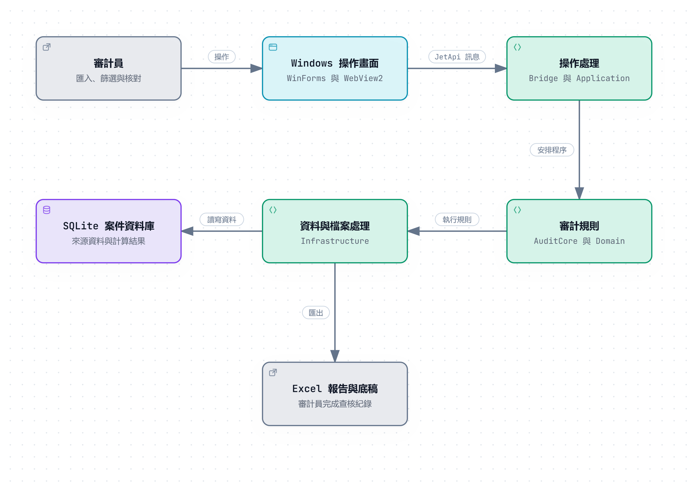

## 1. Document Overview & Control

| 項目 | 內容 |
|---|---|
| 軟體名稱與版本 | JET 1.0.0.0，首次發布。 |
| 文件目的 | 說明 JET 的範圍、架構、相依元件、安全、測試與部署。 |
| 讀者 | 審查 JET 的人員，以及維護 JET 的開發人員。 |
| 文件負責人 | 待填 |
| 核准狀態 | 草稿 |
| 複核日期 | 待填 |

| 版次 | 日期 | 修訂說明 |
|---|---|---|
| 0.1 | 2026-11-10 | 初版。 |

## 2. Software Overview & Scope

JET 是協助審計員執行分錄測試的 Windows 桌面工具。審計員匯入受查者提供的總帳與試算表，依六個步驟完成欄位配對、資料驗證、預篩選與條件篩選，最後匯出 Excel 工作底稿。

| 項目 | 內容 |
|---|---|
| 主要功能 | 建立案件、匯入資料、欄位配對、資料驗證與測試、進階條件篩選、匯出底稿。 |
| 使用者 | 執行分錄測試的審計員。 |
| 系統邊界 | 在使用者電腦上單機執行。案件資料存放在本機 SQLite 資料庫，不連線遠端資料庫或外部服務。 |
| 前提 | Windows 11 64 位元，電腦已安裝 WebView2 Runtime。來源資料由查核團隊取得。 |
| 限制 | 匯入 Access 資料表需要電腦已有 64 位元 Access Database Engine。直接開啟同步資料夾或共用位置上的案件尚未驗證。 |
| 不在範圍內 | JET 不判斷審計結論。案件資料的缺失與風險由審計員判斷並在底稿說明。 |

## 3. Requirements & Constraints

| 類別 | 需求 |
|---|---|
| 功能 | 六個步驟的功能見第 2 節。審計邏輯沿用舊版 IDEA JET，並依查核團隊的作業需求調整。 |
| 效能 | 大量資料的篩選與彙總由 SQLite 處理，畫面只讀取摘要與分頁，明細每頁最多 200 筆。處理時間尚未建立基準。 |
| 可用性與延展性 | 不適用。JET 是單機程式，沒有常駐服務；每個案件使用一個資料庫檔。 |
| 無障礙 | 本次未訂定需求。 |
| 安全 | 見第 12 節。 |
| 相容性 | Windows 11 64 位元。匯入 Excel（.xlsx、.xlsm、.xls）、文字檔（.csv、.txt）與 Access（.mdb、.accdb），輸出 Excel（.xlsx）。 |
| 驗收條件 | 自動測試全部通過；程式碼審查的結論為通過；SAT 測試情境全部通過。 |

## 4. Technology Stack & Dependencies

| 項目 | 採用內容 |
|---|---|
| 語言與框架 | C#、.NET 10（net10.0-windows）。WinForms 提供視窗，WebView2 顯示隨程式提供的網頁。 |
| 畫面 | HTML、CSS 與 JavaScript；圖表使用 Apache ECharts。 |
| 資料庫 | SQLite。使用 Microsoft.Data.Sqlite 10.0.13 與 SQLitePCLRaw.bundle_e_sqlite3 3.0.5，原生 SQLite 為 3.53.4。 |
| Excel 與 Access | DocumentFormat.OpenXml 3.5.1、ClosedXML 0.105.1、ExcelDataReader 3.9.0、System.Data.OleDb 10.0.13。 |
| 其他套件 | Microsoft.Web.WebView2 1.0.4258.31、Microsoft.Extensions.Logging 10.0.13。 |
| 外部服務 | 無。 |
| 相容性限制 | 只發布 win-x64。WebView2 Runtime 與 Access Database Engine 使用電腦上已安裝的版本，不隨 JET 發布。 |

完整元件清冊與相依風險見第 5 節。

## 5. Dependency Security: SBOM & SCA

### 5.1 SBOM Inventory & Traceability

| 項目 | 內容 |
|---|---|
| 涵蓋範圍 | 產品專案直接引用 9 個 NuGet 套件，含間接引用共 23 個；另列 34 個僅供測試的套件，以及隨程式提供的 ECharts、圖示與字型。 |
| 不涵蓋 | Windows、Office、Access Database Engine 與 WebView2 Runtime；這些元件不隨 JET 發布。 |
| 清冊 | 直接引用的元件列在下表。套件與版本宣告在 JET/JET.csproj 與 tests/JET.Tests/JET.Tests.csproj。 |
| 產生方式 | 依專案的套件還原結果整理，授權依各套件宣告與來源條款核對。 |
| 格式 | 含間接引用的完整清冊，尚未以 SPDX 或 CycloneDX 格式輸出。 |
| 對應版本 | 1.0.0.0。提交編號與發布檔識別：待填 |

產品元件沒有另購商用版的要求，仍須遵守各元件的散布條件。NuGet 授權聲明尚需納入正式發布包。

直接引用的元件：

| 元件 | 版本 | 授權 |
|---|---|---|
| ClosedXML | 0.105.1 | MIT |
| DocumentFormat.OpenXml | 3.5.1 | MIT |
| ExcelDataReader | 3.9.0 | MIT |
| Microsoft.Data.Sqlite | 10.0.13 | MIT |
| Microsoft.Extensions.Logging | 10.0.13 | MIT |
| Microsoft.Extensions.Logging.Abstractions | 10.0.13 | MIT |
| Microsoft.Web.WebView2 | 1.0.4258.31 | Microsoft 的 BSD 三條款授權 |
| SQLitePCLRaw.bundle_e_sqlite3 | 3.0.5 | Apache-2.0 |
| System.Data.OleDb | 10.0.13 | MIT |
| Apache ECharts（含 d3.js 子元件） | 5.5.0 | Apache-2.0；d3.js 為 BSD-3-Clause |
| Fluent UI System Icons | 1.1.344 | MIT |
| Noto Sans TC、Instrument Sans | 字型檔 | SIL Open Font License 1.1 |

### 5.2 SCA & Remediation

| 項目 | 內容 |
|---|---|
| 工具與範圍 | .NET SDK 的套件漏洞查詢，範圍為產品專案的直接與間接引用。 |
| 資料來源 | 專案設定的 NuGet 套件來源所提供的公開漏洞資料。 |
| 查詢日期與結果 | 2026-11-06 查詢成功，未列出已知漏洞。 |
| 已處理事項 | CVE-2025-6965（CVSS 4.0 分數 7.2）影響 SQLitePCLRaw 舊原生套件 2.1.11 及以前版本，SQLite 修正版本為 3.50.2。目前使用的 SQLite 3.53.4 已高於修正版本。 |
| 授權檢查 | 逐一核對各元件的授權與散布義務。直接引用元件的授權見 5.1。 |
| 處理責任與期限 | 由開發人員更新套件並重新查詢。處理期限尚未訂定。 |
| 例外核准 | 無。 |

查詢命令：

```
dotnet package list --project JET/JET.csproj `
  --no-restore --vulnerable --include-transitive `
  --format json --output-version 1
```

### 5.3 CI/CD & Release Evidence

本專案沒有 CI/CD 管線，套件漏洞查詢在開發電腦執行。更新套件後重新查詢；正式發布前對最終發布檔再查一次。

| 項目 | 內容 |
|---|---|
| 1.0.0.0 的清冊與查詢報告 | 清冊見 5.1，查詢結果見 5.2。 |
| 未結案事項與核准的例外 | 無。 |
| 核准決定與簽核日期 | 待填 |

## 6. System Architecture



| 部分 | 職責 |
|---|---|
| 操作畫面 | WinForms 承載 WebView2，顯示隨程式提供的網頁，負責輸入與結果呈現。 |
| 操作處理 | Bridge 接收畫面訊息，Application 安排處理順序與回應。 |
| 審計規則 | AuditCore 與 Domain 定義計算、納入範圍及資料意義。 |
| 資料與檔案處理 | Infrastructure 執行 SQLite 查詢、資料匯入及 Excel 輸出。 |
| 案件資料庫 | SQLite 保存來源資料、配對結果及計算結果。 |
| 報告與底稿 | 報告可重新產生；正式工作底稿每次匯出保留新版本，不覆寫舊檔。 |

畫面與 C# 之間只透過一條訊息通道溝通：畫面送出操作名稱與參數，C# 回傳結果摘要，明細另以分頁讀取。

| 設計決定 | 原因與取捨 |
|---|---|
| 大量資料留在 SQLite，以 SQL 篩選與彙總 | 畫面不必載入整份總帳；每次查詢都經過資料庫。 |
| 以 WebView2 顯示畫面 | 畫面以網頁技術開發；電腦需要 WebView2 Runtime。 |
| 單機、每案一個資料庫檔 | 不需要資料庫伺服器；搬移案件時複製整個案件資料夾。 |
| 審計規則集中在核心模組 | 畫面與報告沿用同一份結果，不各算一套。 |

## 7. Diagrams & Technical Design

| 圖表 | 位置 |
|---|---|
| 系統組成圖 | 第 6 節 |
| 資料表關聯圖（ERD） | Diagrams/ERD.png，文字定義為 Diagrams/ERD.txt |
| UML 類別圖 | Diagrams/UML Diagram.png，文字定義為 Diagrams/UML Diagram.txt |
| 循序圖與資料流程圖 | 本次未製作 |

**圖表說明**

資料表關聯圖列出案件資料庫的全部資料表與欄位，依匯入來源、配對與整理後的資料、規則與結果、系統紀錄分成四組。資料表之間的線代表 SQL 查詢使用的關聯欄位；資料庫沒有宣告外鍵。

UML 類別圖以「資料驗證」與「匯出工作底稿」兩項操作為例，畫出畫面送出操作後接手的主要類別。

兩張圖都由現行程式產生或核對，程式改動後重新產生。

**信任邊界**

JET 在單一程序內執行。WebView2 只載入隨程式提供的頁面，阻擋外部導覽與新視窗。程式不對外連線，來源檔與輸出檔都由使用者在本機選取。

## 8. Source Code Structure & Development Standards

路徑以方案檔 JET.slnx 所在的資料夾為起點。

| 位置 | 內容 |
|---|---|
| JET.slnx | 方案檔，包含產品專案與測試專案。 |
| JET/Form1.cs、Program.cs | 啟動視窗及 WebView2。 |
| JET/wwwroot | 畫面、字型與圖示。 |
| JET/Bridge、Application | 接收操作與安排處理。 |
| JET/AuditCore、Domain | 審計規則與基本資料定義。 |
| JET/Infrastructure | SQLite、匯入及報告輸出。 |
| JET/Templates | 隨程式交付的八份 Excel 範本。 |
| tests/JET.Tests | C# 單元、整合及架構測試。 |
| tests/frontend | 畫面程式的測試，以 Node.js 執行。 |

| 項目 | 做法 |
|---|---|
| 命名 | 同一概念在畫面、報告與程式只用一個名稱。 |
| 程式撰寫 | 見 Design Principle。 |
| 分支 | 單一 main 分支，未使用功能分支與 Pull Request。 |
| 提交 | 訊息使用繁體中文，標題一行說明改了什麼，內文寫主要變更與必要原因。 |
| 修改流程 | 修改後先執行相關測試，由專案負責人確認後提交。 |

## 9. Development Environment & Configuration

| 項目 | 用途與需求 |
|---|---|
| Windows x64 | 開發及執行桌面程式。 |
| .NET 10 SDK | 編譯 C# 與執行測試。 |
| Node.js 26 | 執行畫面程式的測試。 |
| Visual Studio 或 VS Code | 閱讀、偵錯及發布程式。 |
| Microsoft Excel | 檢查產出工作簿的實際操作及相容性。 |

以 Visual Studio 開啟 JET.slnx，或以 VS Code 開啟方案資料夾。建置與啟動：

```
dotnet build JET.slnx -c Debug
dotnet run --project JET/JET.csproj -c Debug
```

JET 不讀取環境變數，也沒有需要填寫的密碼或金鑰。開發與正式環境使用相同的程式設定，差別只在建置組態（Debug 或 Release）。

## 10. Data Design & Management

每個案件一個資料夾，預設位於 %USERPROFILE%\JET，內含案件設定檔、SQLite 資料庫、報告及日誌。資料表與欄位見 Diagrams/ERD.png。

| 項目 | 內容 |
|---|---|
| 資料模型 | 來源資料原樣保存；欄位配對後另建整理過的總帳與試算表。驗證結果、預篩選結果、抽樣樣本、篩選情境與操作紀錄各有資料表。 |
| 金額 | 以整數保存到小數第四位，顯示格式不改變計算值。 |
| 驗證 | 匯入時檢查各來源的欄位是否一致。配對後核對存入的筆數與合計。 |
| 結構版本 | 資料庫記錄結構版本，目前為第 20 版。版本不符時不寫入，請審計員刪除案件後重建；沒有逐版升級程序。 |
| 保存與清除 | 案件資料留在本機，由使用者保存或刪除，JET 不自動清除。 |
| 備份與復原 | 正常關閉 JET 後複製整個案件資料夾。 |
| 機敏資料 | 案件資料可能含客戶機密與人員名稱，只在本機處理。支援日誌不記錄案件內容。資料庫未另行加密。 |

## 11. APIs & External Integrations

JET 沒有對外的 API，也不呼叫外部服務。

畫面與 C# 之間使用內部訊息通道，各項操作的處理程式在 JET/Application/Handlers。

| 項目 | 內容 |
|---|---|
| 請求 | requestId、action（操作名稱，例如 validate.run）與 payload。 |
| 成功回應 | 相同的 requestId、ok 為 true，以及 data。 |
| 失敗回應 | ok 為 false，error 內含固定的錯誤碼與中文訊息。 |
| 驗證 | 不適用。通道只存在於同一個程序內，WebView2 只載入隨程式提供的頁面。 |
| 逾時與重試 | 不適用。長時間作業顯示進度，可由使用者取消。 |
| 版本 | 通道隨程式版本發布，不另外編號。 |
| 檔案介面 | 以 Open XML 讀寫 Excel；以 Access Database Engine 讀取 Access 資料表。 |

## 12. Application Security & GitHub Security

### 12.1 Application Security

| 項目 | 做法 |
|---|---|
| 身分與權限 | JET 不另設登入，以目前登入 Windows 的帳號識別操作人員。案件檔案的存取由 Windows 檔案權限控管。 |
| 資料保護 | 案件資料只在本機處理，不傳送到外部。 |
| 輸入驗證 | SQL 查詢值以參數傳入；欄位與排序限制在程式允許的清單。 |
| 機密管理 | 原始碼不含密碼、金鑰或權杖。 |
| 介面與執行期 | WebView2 限定內建網址，阻擋外部導覽與新視窗，停用網頁直接存取主程式物件。非預期錯誤不顯示內部例外原文。 |
| 檔案輸出 | 報告先寫入暫存位置，成功後才發布；正式工作底稿不覆寫既有檔案。 |
| 弱點通報與處理 | 待填 |

### 12.2 GitHub & Repository Security

JET 1.0.0.0 是代碼庫的首次提交。下列設定於代碼庫建立後填入，GitHub 的掃描結果存放在 Github Security Reports 資料夾。

| 項目 | 設定 |
|---|---|
| 存取 | 待填 |
| 分支保護與必要審查 | 待填 |
| 機密掃描與推送保護 | 待填 |
| 程式碼掃描 | 待填 |
| 相依套件警示與審查 | 待填 |
| 工作流程權限 | 不適用，沒有 GitHub Actions 工作流程。 |

## 13. Code Review

審查依 Code Review/Code review rule.docx 辦理：以單元測試結果為主要驗收依據，人工審查補足程式內的固定值與業務規則。

| 步驟 | 內容 |
|---|---|
| 作者提交 | 變更說明、受影響的程式、程式版本、Unit test Report，以及固定值與規則清單。 |
| 審查者確認 | 核對測試結果與涵蓋範圍，人工檢視程式，以及固定值與規則的來源。 |
| 作者處理 | 修正發現的問題，重跑受影響的測試並更新紀錄。 |
| 審查者記錄 | 在 Code review.xlsx 填寫結論、審查者、日期、核准的程式版本與後續事項。 |

JET 1.0.0.0 是首次提交，審查範圍為全部原始碼。審查紀錄、主要功能與對應的測試，以及固定值與規則清單，記在 Code review.xlsx。結論分為通過、需修正、例外核准三種。本專案未使用 Pull Request，審查紀錄以提交編號對應程式版本。

## 14. Testing & Quality Assurance

| 測試 | 內容 |
|---|---|
| 單元、整合與架構測試 | C# 測試，使用 xUnit v3，位於 tests/JET.Tests。 |
| 前端測試 | 以 Node.js 內建的測試執行器載入 JET/wwwroot 的畫面程式，用模擬的頁面元素與合成的後端回應操作畫面，核對畫面內容與送出的資料，位於 tests/frontend。 |
| 回歸測試 | 修改後重跑受影響的測試；發布前執行完整的自動測試。 |
| 效能測試 | 未建立基準。 |
| 安全測試 | 套件漏洞查詢與限定範圍的原始碼檢視，見第 5 節與第 12 節。 |
| 端對端與驗收測試 | 依 SAT 測試情境逐項操作六個步驟，結果記錄在測試情境文件。 |

自動測試全部使用合成資料。C# 測試在建置方案後執行測試專案產生的測試程式，需要方案資料夾以外的資料或檔案的三組測試以參數排除。前端測試不需要建置，以 Node.js 直接執行；一次最多同時執行 4 個測試檔，合計占用的記憶體才不會隨 CPU 核心數增加。執行的命令如下：

```
dotnet build JET.slnx -c Debug
tests/JET.Tests/bin/Debug/net10.0-windows/JET.Tests.exe `
  --filter-not-trait "TestProfile=PrivateCase" "TestProfile=Scale" "TestProfile=DevelopmentRepository"
node --test --test-concurrency=4 tests/frontend/
```

測試結果與 C# 行涵蓋率見 Code Review/Unit test Report.xlsx。涵蓋率只計 C# 程式，不含前端 JavaScript 與原生元件。

## 15. Build, CI/CD & Deployment

本專案沒有 CI/CD 管線。建置、測試與封裝在開發電腦執行。

| 項目 | 內容 |
|---|---|
| 建置與封裝 | 以 FolderProfile 發布 Release、win-x64 的自含式單一執行檔 JET.exe，連同 wwwroot 與 Templates 資料夾一起交付。 |
| 發布前檢查 | 自動測試全部通過後才封裝發布檔。 |
| 環境推進與核准 | 開發測試、驗收測試、正式部署。各階段的核准：待填 |
| 部署前提 | Windows 11 64 位元與 WebView2 Runtime。不需安裝程式，把發布資料夾放到電腦上即可執行。 |
| 資料移轉 | 不適用。沒有伺服器資料庫，案件資料庫由程式建立。 |
| 復原 | 換回前一版的發布資料夾。1.0.0.0 是第一版，沒有前一版。 |
| 部署後確認 | 以一般使用者帳號開啟 JET，建立案件並走完六個步驟。 |

## 16. Operations, Monitoring & Troubleshooting

| 項目 | 內容 |
|---|---|
| 日誌 | 畫面左下角的「訊息」區顯示操作訊息，可複製紀錄或輸出支援日誌。 |
| 指標、警示與健康檢查 | 不適用。JET 是單機桌面程式，沒有常駐服務。 |
| 常見問題 | 報告檔無法寫入時，關閉開啟該檔案的程式，確認檔案不是唯讀後重新匯出。修改匯入資料或欄位配對後，篩選情境會被清除，需要重新設定。 |
| 診斷 | 回報問題時附上錯誤訊息的畫面、發生前的操作步驟與「訊息」區複製的紀錄。維護人員依支援日誌定位，再以合成資料重現。 |
| 復原 | 結果過期或讀不出來時，重新執行該步驟即可恢復；已匯出的工作底稿不受影響。 |
| 支援 | 安裝與電腦環境由 ITS 服務台處理。功能與操作的聯絡窗口：待填 |

## 17. Source Code Change Log

JET 1.0.0.0 是代碼庫的首次提交，沒有先前的修訂。Git 的提交紀錄見 程式修訂紀錄/git_code_changes_log.txt。

| 項目 | 內容 |
|---|---|
| 日期 | 待填 |
| 提交 | 首次提交。提交編號：待填 |
| 異動範圍 | 全部原始碼。 |
| 原因與內容 | JET 1.0.0.0 首次發布，功能見第 2 節。 |
| 相依套件異動 | 不適用。元件清冊見第 5 節。 |
| 測試 | Code Review/Unit test Report.xlsx |
| 相容性影響 | 不適用，沒有先前版本。 |

## 18. Release Notes

各版本的日期、內容與版本號列在 版本更新紀錄.xlsx。

| 項目 | 內容 |
|---|---|
| 版本與日期 | 1.0.0.0，首次發布。日期：待填 |
| 主要功能 | 完整性測試、條件篩選、匯出工作底稿。 |
| 不相容的變更 | 不適用，這是第一個版本。 |
| 已知問題 | 見第 19 節。 |
| 發布檔與佐證 | 待填 |

## 19. Known Issues, Technical Debt & References

| 事項 | 現況 |
|---|---|
| 資料驗證報告的「完整性測試出現差異時之指引」工作表 | 沿用舊版範本內容，改寫待與 DPP 確認。 |
| 資料驗證報告 step1-3 的鎖定範圍 | 「step1-3 完整性測試之差異說明」受保護時，除了程式寫入的科目編號、科目名稱與差異金額，表頭區的部分空白格、資料右側 I 欄以後的格子，以及最後一筆以下的列也不能填，比舊版鎖得多；是否改成只鎖這三欄待確認。 |
| 同步資料夾與共用位置 | 直接開啟這類位置上的案件尚未驗證。 |
| 部署環境 | 一般使用者權限下的操作與大量資料的處理時間，尚未在部署環境的電腦上實測。 |
| 畫面訊息通道 | 接收畫面訊息時沒有再檢查來源網址；視窗已限定只載入隨程式提供的頁面。 |
| 授權聲明 | 第三方授權聲明檔尚未放入發布包。 |
| 標準格式的 SBOM | 尚未輸出 SPDX 或 CycloneDX 格式。 |

參考資料：[Microsoft 測試涵蓋率](https://learn.microsoft.com/dotnet/core/testing/microsoft-testing-platform-code-coverage)；[NuGet 漏洞查詢](https://learn.microsoft.com/dotnet/core/tools/dotnet-package-list)；[SQLite 漏洞公告](https://github.com/advisories/GHSA-2m69-gcr7-jv3q)；[SQLite 授權](https://www.sqlite.org/copyright.html)；[WebView2 SDK 授權](https://www.nuget.org/packages/Microsoft.Web.WebView2/1.0.4258.31/License)；[WebView2 安全建議](https://learn.microsoft.com/en-us/microsoft-edge/webview2/concepts/security)。
